<p align="center"></p>

# Tilly

*Keeps your agents in line, and you improving.*

Tilly is a desktop app for people who hand real work to AI coding agents: Claude Code and GitHub Copilot. It watches the agents' logs on your computer and answers two questions:

1. **Right now: which agents need me?** Agents stall silently: waiting for an answer, a permission prompt, or a failed run nobody noticed. Tilly shows every live session by status, puts the ones waiting on you first, and can play a sound or show a notification when one needs you, even with its window closed.
2. **Over time: am I getting better at this?** Most tools stop at tokens and cost. Tilly tracks **execution**: did the work ship, what did it take, and which of your habits (planning first, using a reviewer agent, smaller tasks) actually make a difference. Then it helps you try a change and measure it.

Everything stays on your computer. Tilly runs on macOS and Windows, and is built with Tauri 2, Rust and React.

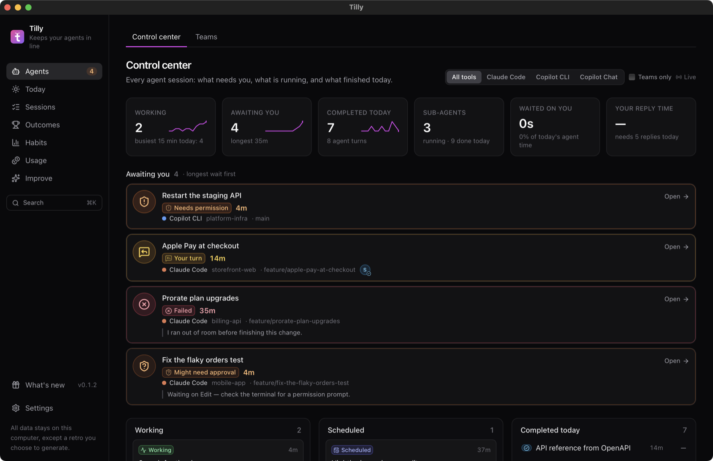

**[Download Tilly](https://github.com/xanderlynn/tilly/releases/latest)** · [A quick tour](#a-quick-tour) · [Your first week](#your-first-week) · [FAQ](#faq) · [What's new](CHANGELOG.md)

## A quick tour

*All screenshots use made-up demo data ([`scripts/demo-data.mjs`](scripts/demo-data.mjs)), not anyone's real sessions.*

### Agents: what needs you, right now

The **Control center** is where Tilly opens. Each session gets one status, worked out from its log (table below). The *Awaiting you* queue puts the longest wait first and shows what the agent asked or is stuck on. Above it: how many agents are working, how long they have waited on you today, and your reply time.

| Status | Means |
| --- | --- |
| **Your turn** | The agent finished and asked you something, or is waiting on a question or plan approval. |
| **Needs permission** | Waiting for you to approve a tool call (Copilot logs these). |
| **Might need approval** | A file, web or MCP tool call has had no result for 45 seconds. Claude Code doesn't log permission prompts, so this is a best guess. |
| **Failed** | The latest turn ended in an error or hit the output limit. |
| **Working** / **Long task** | At work; a long task has been quiet mid-turn for over two minutes (a build, a long command, a sub-agent). |
| **Scheduled** | Idle now, with work scheduled to run later. |
| **Completed** / **Closed** | Finished its turn without asking you anything, or the tool closed the session. |
| **Idle** | No activity for 30 minutes: stalled, or the tool was closed. |

Sessions stay in the live view for three hours after their last turn, and one waiting on you (a question or a permission prompt) stays for a day, so a question asked overnight is still there in the morning. The sidebar's **Agents** badge counts the ones awaiting you, and the menu-bar (tray) menu lists them, each a click away. Notifications say what the agent wants and remind you a few times, every 15 minutes, while it's still waiting; clicking one opens that session. **Today** opens with what finished, failed or started waiting while you were away. Sessions are labelled by the app that ran them: Claude Code, the Claude app, Copilot CLI, the Copilot app or Copilot in VS Code. **Go to agent** brings forward where a session runs so you can answer it: the Claude or Copilot app, VS Code on its folder, or a command-line agent's own Terminal or iTerm tab.

A session that has waited on you for over three hours is **Parked**: folded away, out of the badge and the tray, until you open it. **Dismiss** clears one you've already dealt with somewhere else.

Copilot logs its permission prompts, so Tilly sees them exactly. Claude Code doesn't, so Tilly can only guess (**Might need approval**) and misses Bash prompts. For exact ones, open **Settings → Claude Code permission prompts** and add Tilly's hook: one entry in Claude Code's `settings.json` (the previous file is kept as `settings.json.tilly-backup`) that passes Tilly the session and the tool it wants, nothing else. It covers Claude Code in a terminal and in the Claude app. A prompt you've approved shows as answered once the command finishes and Claude writes its next step.

**Workstreams** shows larger efforts that span sessions: everything on one feature branch, or a session whose agent kept a task list. Each card shows progress (done, in progress, waiting on you), the agents on it and their latest update. Open one for its task tree, built from the agents' own task lists (Claude Code's todos and plans, Copilot's todos): each task is marked as agent work or yours (approvals, decisions, credentials, release steps, or anything the agent is waiting on you for), and you can change who it's for.

Make workstreams your own: **star** one to keep it at the top and listed whatever its age, make a **new workstream** and add sessions to it (a session brings its feature branch, so later sessions on that branch join too), or rename one. **Import from tracker** builds one from any GitHub issue or Azure DevOps work item, at any level: an epic, feature, user story, task or bug. Whatever is under it becomes its tasks (sub-issues or the task list in its description, or child work items, three levels deep); one with nothing under it is tracked as a single task. An `agent` or `human` label or tag sets who does each, and recent sessions that mention it or its items join it. While Tilly runs it stays current on its own: it's fetched again every 15 minutes (change or turn this off in Settings › Workstreams) and when you come back to the window, and a card says **Out of date** with the reason if a fetch fails. Opening one or pressing Sync fetches it straight away. Tilly fetches through your own `gh` or `az` sign-in and stores no token. To keep your team in the loop, **Share progress** drafts a comment for the epic (item by item, with agent time, commits and PRs, but no costs) that you can edit and post, and an item you've marked as agent or human work can get that label in the tracker. Nothing is written to your tracker unless you press the button.

| Workstreams | One workstream |
| --- | --- |
| 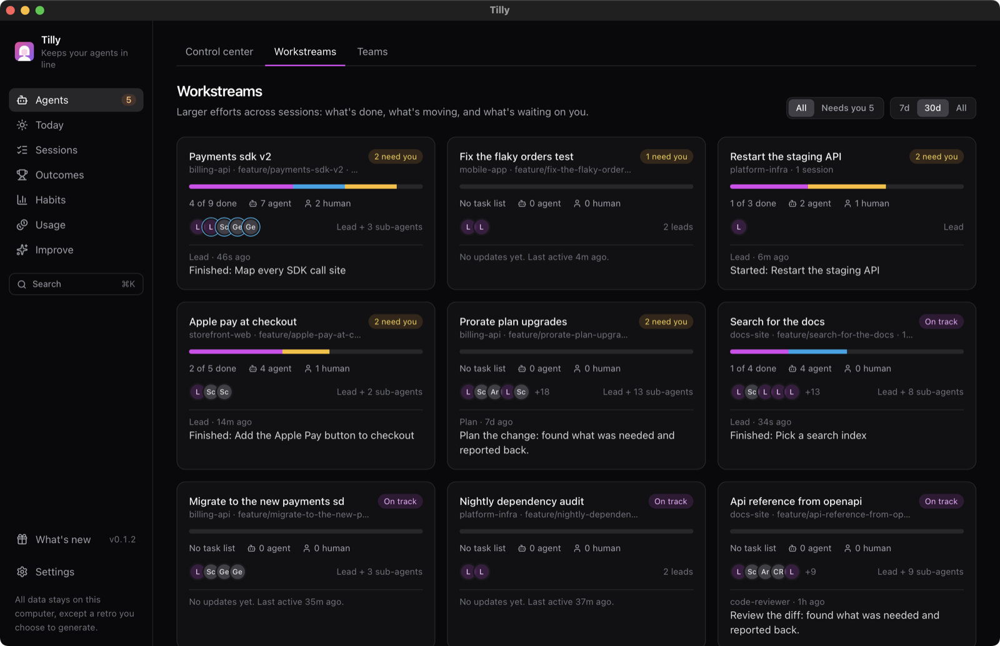 | 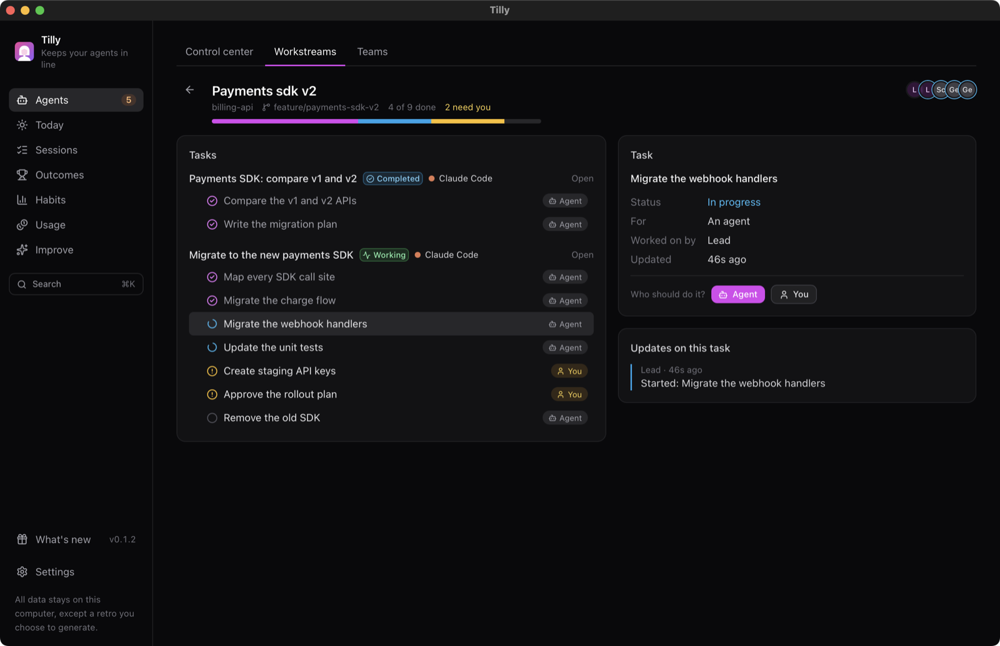 |

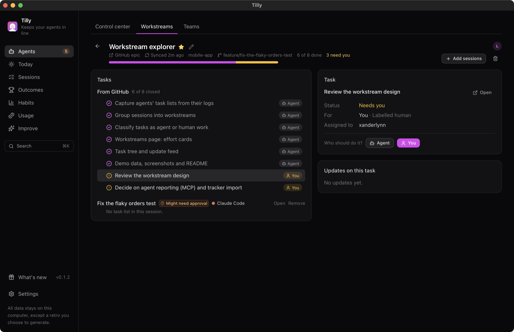

The list opens on **Active** workstreams (touched in the last three days, or needing you), with All, Starred and Needs you, and a search box. A card says **Stalled** after two weeks without activity; **Archive** puts one away, and **Progress** lists the ones you finished.

**Teams** shows sessions where the lead agent handed work to sub-agents: who is on each team, what each was asked to do, whether it reported back, and what is scheduled to run later.

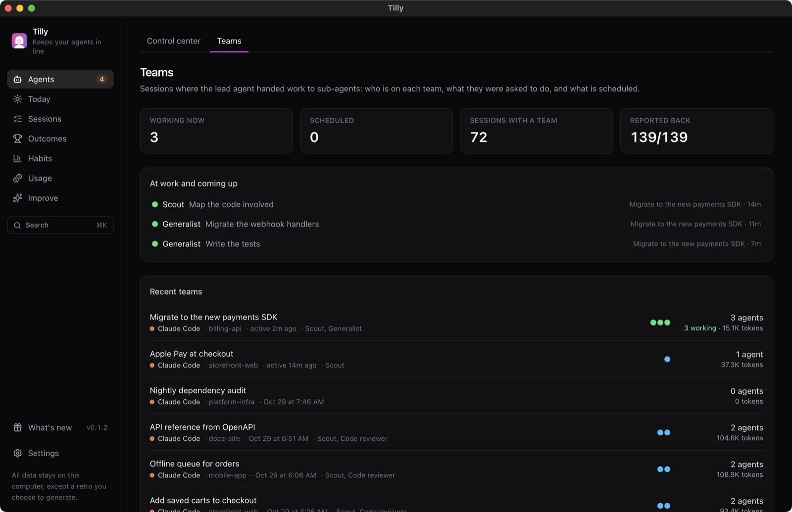

### Today and Sessions: review in one tap

**Today** lists what finished recently so you can rate each one (shipped, partial, abandoned, redo) in a click. Ratings are what turn activity into insight. **Sessions** holds every session from every tool, searchable across all your prompts; open one to see its timeline, its team, and the commits it produced.

| Today | Sessions |
| --- | --- |
| 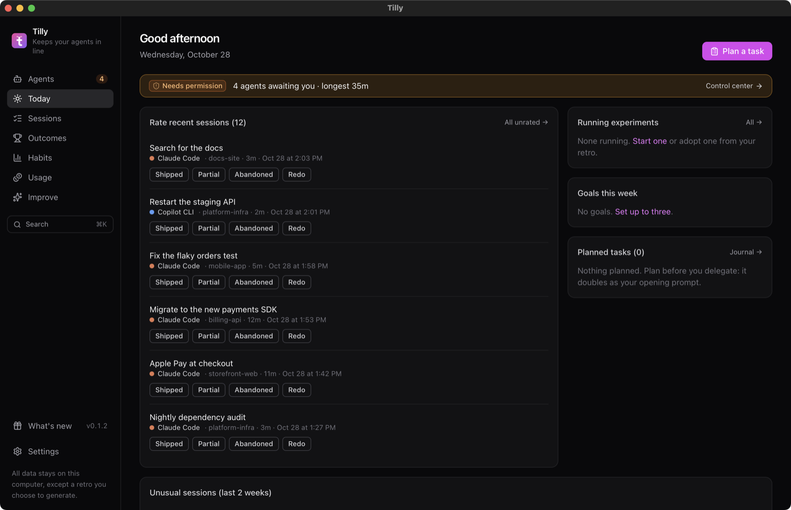 | 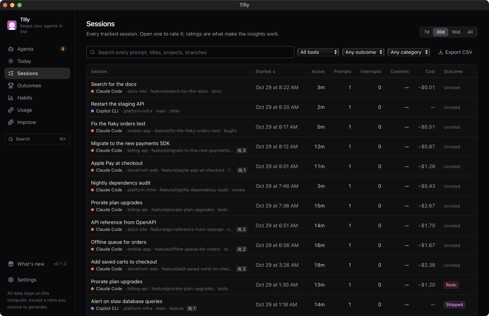 |

### Outcomes and Habits: what actually works for you

**Outcomes** shows how often sessions ship, with your usual range so a good or bad week stands out, and insights you can click through to the sessions behind them. **Habits** shows when you work, what you delegate and how it goes, and how the agent spends its time. **Toolkit** lists the agent roles, tools, MCP servers and skills you use, and compares how sessions went with each one against sessions without it.

| Outcomes | Patterns |
| --- | --- |
| 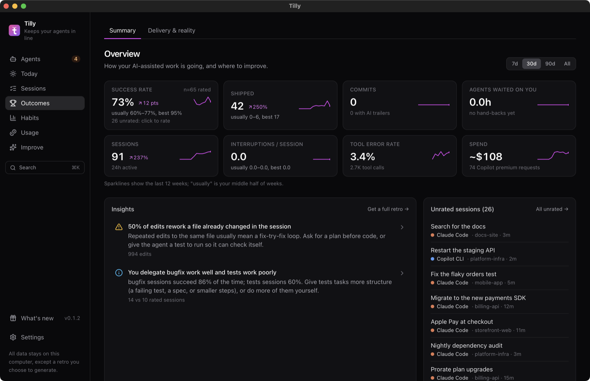 | 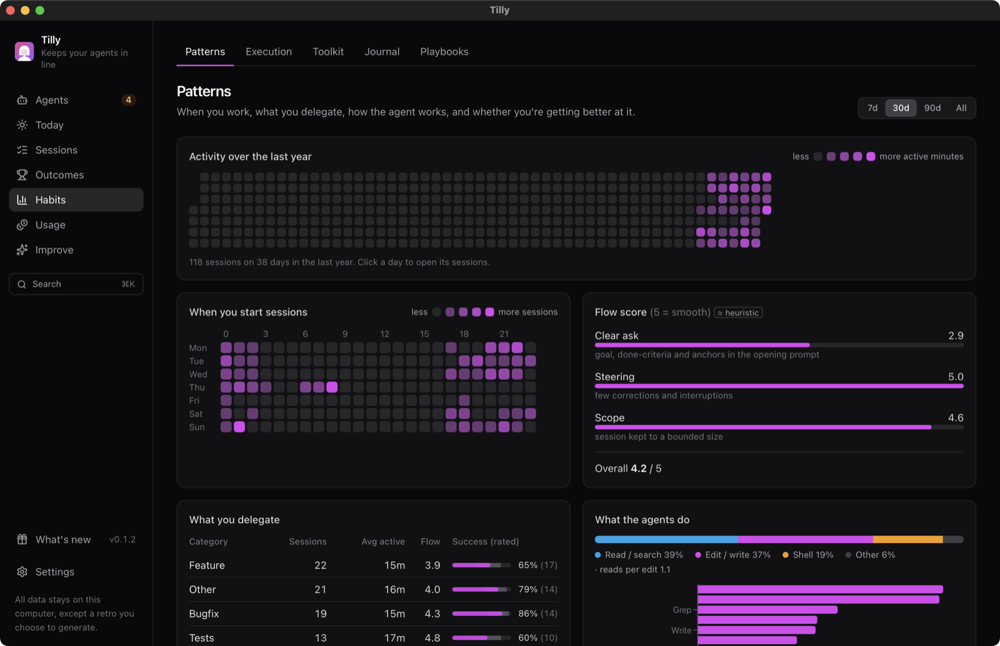 |

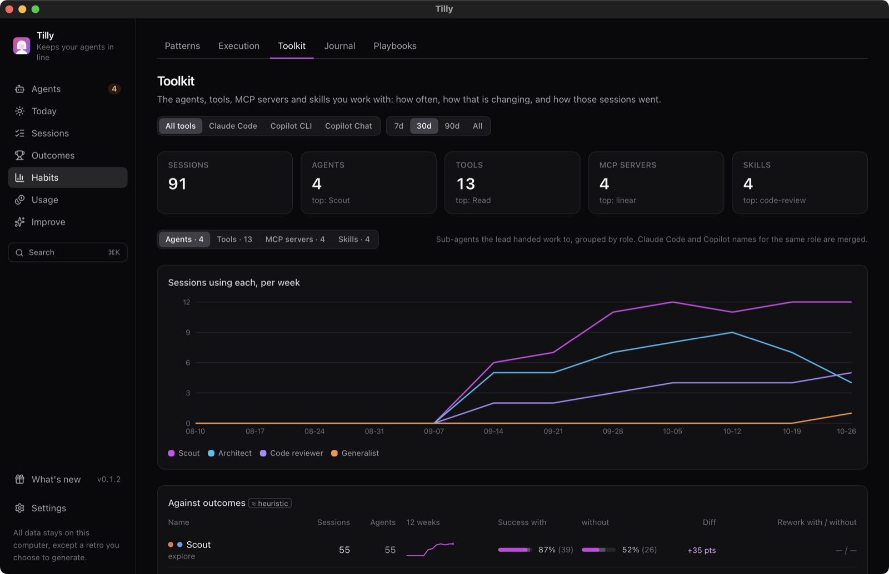

**Progress** answers "did I get better?": success, cost per shipped, reply time and waiting month by month, with one line on the trend, and what pays off by team size, app and kind of work. On Habits, **Your attention** splits agents' waiting on you into replying and away spells, by hour and by project. A session whose pull request merged suggests Shipped, and Today confirms suggestions in one click.

### Usage: tokens and spend

Tokens and spend by tool and model, month-to-date against pace, cache savings, and the cost of each *shipped* session rather than each session.

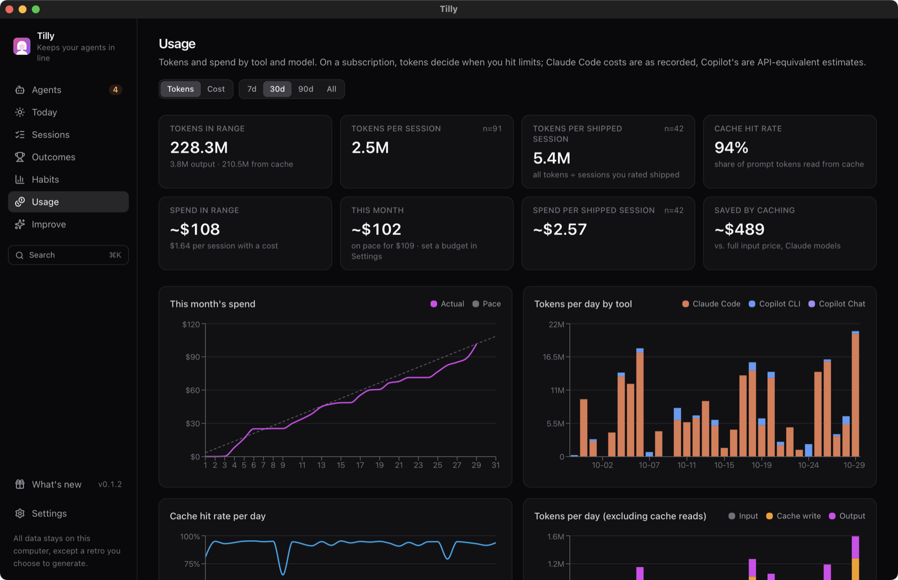

### Improve: change one habit and measure it

A **weekly retro** starts with your own reflection, then Claude reviews the measured results and suggests three experiments. An **experiment** locks a baseline, tracks whether you stuck to the habit, and ends in keep, drop or extend. **Goals** come with a counter-metric so you can't hit one by gaming it.

### Make it yours

Pick a sound (a built-in tone or your own WAV or Ogg file), an image and a volume for each status, with quiet hours, mute and background-only alerts. Themes, accents and density are in Settings too.

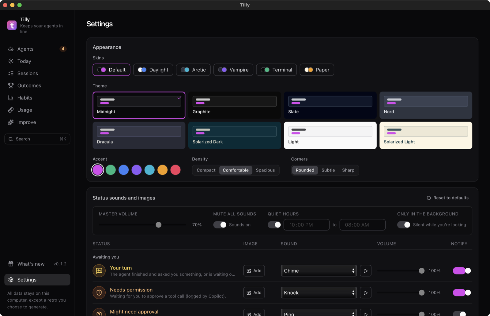

**Storage and history** in Settings keeps every session's summary forever, so trends cover all your history, but compacts the detail of sessions older than 180 days and deletes archived transcripts after 90 days (compressed after a week). A heavy year of use then stays near 85 MB rather than 140 MB, plus the archive. Each limit is adjustable, or forever.

Press ⌘K (Ctrl+K on Windows) anywhere to jump to a page or search every prompt you've written.

## Your first week

1. **Leave it running.** Let it tell you when an agent needs you, and pick which statuses make a sound in Settings.
2. **Rate sessions as they finish.** **Today** lists them; one click each: shipped, partial, abandoned or redo. Ratings power the insights; 10 to 20 are enough to start seeing patterns.
3. **Look at Outcomes after a week:** your success rate, and which kinds of task you delegate well.
4. **Try one experiment.** Pick one habit, say "ask for a plan before code on multi-file changes", and let **Improve** measure it against your baseline.

## Data sources

| Tool | Where it reads from |
| --- | --- |
| Claude Code (CLI, VS Code extension, desktop app) | `~/.claude/projects/**.jsonl` (or `$CLAUDE_CONFIG_DIR`) |
| GitHub Copilot CLI | `~/.copilot/session-state/*/events.jsonl` (or `$COPILOT_HOME`) |
| Copilot Chat in VS Code / Insiders / VSCodium | `<config>/Code/User/workspaceStorage/*/chatSessions/` |

The app watches these folders and updates within seconds. Claude Code deletes transcripts after 30 days by default, so the app keeps its own copy (configurable in Settings).

Copilot is a subscription, so the dollar figures for Copilot sessions are API-equivalent estimates for comparison. For Claude Code the app uses the cost Claude Code records itself.

Copilot inline completions are not logged to disk, so they can't be tracked.

## Privacy

- Everything lives in a single SQLite file in the app data folder (`~/Library/Application Support/com.xanderlynn.tilly` on macOS, `%APPDATA%\com.xanderlynn.tilly` on Windows). Data from the app's earlier names, Governess and Execution Ledger, moves there on first launch, and so does a saved API key.
- Sensitive app-data directories and files are restricted to the owning user. Archived transcripts remain until you delete the app data; disabling archiving only stops new copies. CSV exports are separate files in Downloads and remain until you delete them. See [SECURITY.md](SECURITY.md#retention-and-deletion) for deletion details.
- Update checks fetch GitHub's public release list on launch and once a day; nothing about you is sent, and **Settings › Updates** turns them off. Otherwise nothing leaves the machine unless you click **Generate retro**. That sends the period's metrics, session titles, opening prompts (truncated) and your notes to Claude. **Preview what's sent** shows the exact text first.
- The retro uses your installed `claude` CLI and your existing subscription by default. If you choose the Anthropic API engine instead, the key is stored in the OS keychain, never in the database.

## Install

Download the latest release from the [Releases page](https://github.com/xanderlynn/tilly/releases/latest):

| Platform | File |
| --- | --- |
| macOS 11 or later, Apple Silicon and Intel | `Tilly_<version>_universal.dmg`, or `Tilly_<version>_macos-universal-portable.zip` |
| Windows 10 and 11, x64 | `Tilly_<version>_x64-setup.exe` (or `…_x64_en-US.msi` for managed installs), or `Tilly_<version>_windows-x64-portable.zip` |

Each release lists SHA-256 checksums in `SHA256SUMS.txt`; check a download with `shasum -a 256 <file>` (macOS) or `Get-FileHash <file>` (Windows).

For a portable install, unzip the archive before running it. On macOS, move `Tilly.app` wherever you want and open it; keep the bundle intact. On Windows, run `Tilly.exe` from the extracted folder. The Windows portable build uses the system Microsoft Edge WebView2 runtime, which is included with current Windows 10 and 11 installations; if it has been removed, install the [Evergreen WebView2 Runtime](https://developer.microsoft.com/microsoft-edge/webview2/) first. Portable builds still store settings and the database in the normal per-user app-data directory described under **Privacy**; they do not keep user data beside the executable.

Until the downloads are code-signed, the OS warns on first launch. This applies to both installers and portable archives. On macOS, right-click Tilly and choose **Open**, then **Open** again. On Windows, choose **More info → Run anyway**. Extract the archive before bypassing the warning rather than running Tilly from inside the ZIP.

Tilly lives in the menu bar (macOS) or the system tray (Windows). Closing the window keeps it running so it can alert you; choose **Quit Tilly** from the tray menu to stop it.

## FAQ

**The Control center is empty.** It shows sessions active in the last three hours. Start a Claude Code or Copilot session and it appears within seconds. If your history is missing too, check **Settings → Data sources**, and whether you set `CLAUDE_CONFIG_DIR` or `COPILOT_HOME`.

**A session says "Might need approval" but it's fine.** Claude Code doesn't log permission prompts, so Tilly guesses from a file, web or MCP tool call with no result for 45 seconds. Long-running commands and sub-agents are excluded, and the status clears as soon as the tool returns.

**Why are Copilot costs estimates?** Copilot is a subscription. Tilly prices its tokens at API rates so you can compare tools; it isn't your bill.

**Does Tilly slow my machine?** It reads only new log lines and pushes changes to the window instead of polling. In the tray with eight agents busy it uses under 1% of one CPU core and under 100 MB of memory; the window adds more while it's open and frees it when closed.

**My MP3 alert won't import.** Use WAV or Ogg; MP3 isn't supported.

**I used Governess or Execution Ledger before.** Those were Tilly's earlier names. Your data and saved API key move over on first launch.

**Found a security issue?** See [SECURITY.md](SECURITY.md). Anything else: [open an issue](https://github.com/xanderlynn/tilly/issues).

## Develop

Prerequisites: Node 22+, Rust (stable), and the [Tauri prerequisites](https://tauri.app/start/prerequisites/) for your OS.

```bash
npm install
npm run tauri dev
```

Checks:

```bash
npm run build                      # typecheck + bundle the frontend
npm test                           # frontend unit tests (Vitest)
cd src-tauri && cargo test --workspace         # Rust unit tests (app + core)
cd src-tauri && cargo clippy --workspace --all-targets -- -D warnings
```

To try the app without your own logs, or to retake the screenshots, generate fictional ones into a throwaway home folder and point Tilly at it:

```bash
node scripts/demo-data.mjs logs /tmp/tilly-demo     # six weeks of made-up Claude Code and Copilot sessions, some live
HOME=/tmp/tilly-demo npm run tauri dev              # macOS; once it has read the logs:
node scripts/demo-data.mjs reviews /tmp/tilly-demo  # rates the finished sessions
```

To check the parsers against your own logs (read-only, into a throwaway database):

```bash
cd src-tauri && cargo test --release -p tilly-core real_logs -- --ignored --nocapture
```

### Layout

Tilly runs in the tray. It keeps collecting, tracking statuses and alerting (notifications and sounds) with its window closed; the window is created when you open it and freed when you close it, which is most of the app's memory. Start it with `--background` to go straight to the tray, as at login. The live state is pushed to the window when it changes; nothing polls.

```text
src/                       React UI (pages/, components/, api.ts = typed command wrappers)
src-tauri/
  core/src/                tilly-core: the engine, no UI dependency (shared with a future headless collector)
    sources/               one plug-in per tool (the AgentSource trait): where its logs live, how files group into sessions, how to parse them
    parsers/               one parser per tool → a normalized ParsedSession, read incrementally
    ingest.rs              change detection, parallel parsing (rayon), upserts, archiving
    enrich.rs              steps run after ingest (commits, playbooks, intents), listed in ENRICHERS
    watcher.rs             filesystem events, periodic scans, live state pushed to a Sink
    live.rs                each session's status and today's live stats
    codegen.rs             writes src/generated.ts (tool ids, statuses, shared thresholds); a test fails if it is stale
    status_alerts.rs       which status changes to announce, per your profile
    team.rs, toolkit.rs    sub-agents and their messages; agents, tools, MCP servers, skills
    store.rs               the sessions table as rows for the read models (by range, filter or id)
    analytics/             session detail, overview, scorecard; insights.rs holds the insight rules (one function each, listed in RULES)
    trends.rs, experiments.rs, journal.rs, playbooks.rs, git.rs
  src/                     the desktop app
    background.rs          tray, window lifecycle, and the Sink: window events, notifications, sounds
    sound.rs               alert tones (synthesised) and your WAV/Ogg files
    retro.rs               the weekly retro (claude CLI or Anthropic API)
    commands.rs            the Tauri command surface; failures reach the UI as { kind, message }
    logging.rs             logs/tilly.log in the data folder (Settings › Data › Show log)
```

**Adding an agent tool.** Write its parser in `core/src/parsers/`, then a plug-in in `core/src/sources/` that implements `AgentSource` (its id, label, log folders, session discovery and parsing; resume commands and instruction files are optional), and list it in `Source::ALL` in `sources/mod.rs`. Ingest, archiving, the watcher, settings and the read models pick it up from there. Then run `UPDATE_GENERATED=1 cargo test -p tilly-core generated_ts` in `src-tauri` so the UI picks up its id and labels, and give it a colour in `src/format.ts`.

## Releases and signing

Versions follow [semver](https://semver.org). `0.x` releases are early: anything may change between minor versions.

Release notes live in [CHANGELOG.md](CHANGELOG.md) ([Keep a Changelog](https://keepachangelog.com) format). Add to the **Unreleased** section as you go; the app shows the notes under **What's new** (a dot marks unread notes after an update; it never opens by itself).

`main` only accepts pull requests that pass CI, so a release takes two steps:

```bash
npm run release -- 0.2.0          # on a release/v0.2.0 branch: moves Unreleased notes under 0.2.0, bumps every manifest, opens a PR
npm run release -- 0.2.0 --tag    # once that PR is merged: tags main as v0.2.0, pushes the tag and creates the draft release
```

The script refuses to release with no notes under Unreleased, and refuses to tag until `main` carries the new version. Only repository admins can create `v*` tags, and nobody can move or delete one. The tag starts `.github/workflows/release.yml`. It first runs CodeQL code scanning on the tagged code (`.github/workflows/codeql.yml`); an error, or a security finding rated high or critical, stops the release before anything is built. It then builds the macOS universal `.dmg` and portable `.app` ZIP, plus the Windows `-setup.exe`, `.msi`, and portable executable ZIP, into a **draft** GitHub Release. It then adds every download to `SHA256SUMS.txt`, records GitHub artifact attestations for the downloads, checksum, and SBOM, and uses the version's CHANGELOG section as the release notes. The macOS ZIP is created with `ditto` so bundle permissions, symlinks, and resource metadata are preserved. The build jobs run in the protected `release` environment, so each run waits until you approve it (the run's page, **Review deployments**). Check the draft, then publish it. A version with a suffix (`0.2.0-beta.1`) is published as a pre-release. The script creates the draft release itself because the `v*` tag ruleset stops the workflow's token from doing so; the workflow uploads into it.

**Updates and rollbacks.** **Settings › Updates** (and an **Update available** button in the sidebar) lists every release newer than the installed one, the installed one, and the one before it. Picking one downloads that release's signed update, verifies it, installs it and restarts, so the same flow handles rolling back. Releases are signed for the updater with a key pair: the public key is in `tauri.conf.json`, and the private key and its password must be the repository secrets `TAURI_SIGNING_PRIVATE_KEY` and `TAURI_SIGNING_PRIVATE_KEY_PASSWORD`. The release workflow fails without them. Keep the private key safe; losing it means existing installs can't verify later updates. Releases from before signing started can't be installed from the app; download those from GitHub.

Every push to `main` also builds installers and portable archives as workflow artifacts (`.github/workflows/build.yml`), for trying a change before it is released.

**Signing.** Code signing and macOS notarization remain pending the required credentials. macOS signing and notarization turn on by themselves once these repository secrets exist: `APPLE_CERTIFICATE` (base64 .p12), `APPLE_CERTIFICATE_PASSWORD`, `APPLE_SIGNING_IDENTITY`, `APPLE_ID`, `APPLE_PASSWORD` (an app-specific password) and `APPLE_TEAM_ID`. They need an Apple Developer account. For Windows, Azure Trusted Signing is the low-cost option; see the [Tauri signing guides](https://tauri.app/distribute/sign/macos/) for both.

## Logo

`public/tilly.svg` is the source for the app icons. After editing it, run `npx tauri icon public/tilly.svg` and delete the `android`, `ios` and `64x64.png` outputs, which the desktop builds don't use. The macOS menu-bar icon, `src-tauri/icons/tray-template@2x.png`, is the same silhouette in black on transparent, with the face cut out (macOS recolours it for light and dark menu bars).

## License and dependencies

Tilly is MIT licensed, and the dependency tree is kept permissive and small:

- **Policy:** only permissive licenses (MIT, Apache-2.0, BSD, ISC, Zlib, Unicode and similar). MPL-2.0 is allowed only for a few crates that come with Tauri and are used unmodified. `src-tauri/deny.toml` and `scripts/check-licenses.mjs` enforce this in CI, so a restrictive dependency fails the build.
- **Notices:** `npm run build` generates `third-party-notices.txt` with every shipped package's license text. It's bundled with the app and viewable under Settings → About and licenses.
- **Fewer dependencies:** Markdown is rendered by a small built-in component instead of a library, and HTTPS uses the operating system's TLS (macOS Security framework, Windows SChannel), not a bundled TLS stack.

```bash
npm run check:licenses
```
